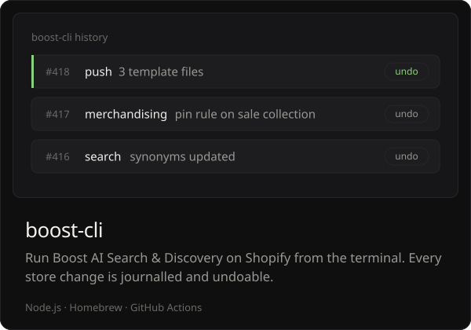
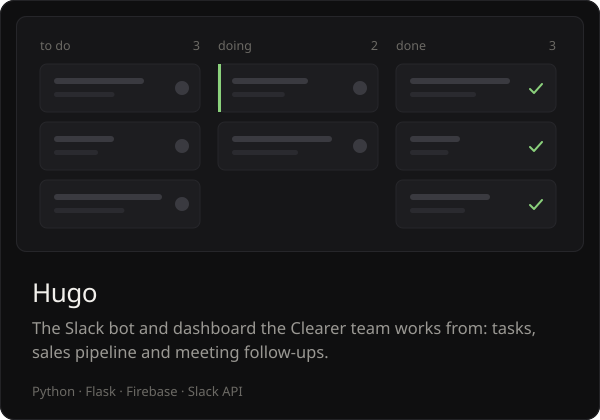
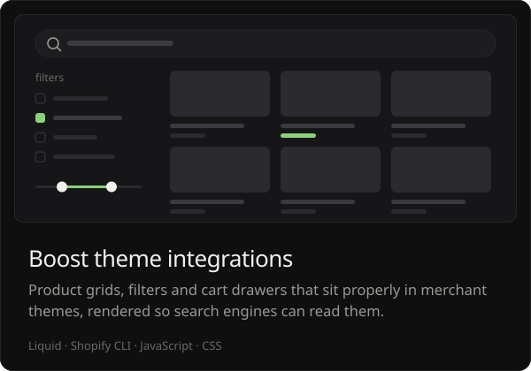
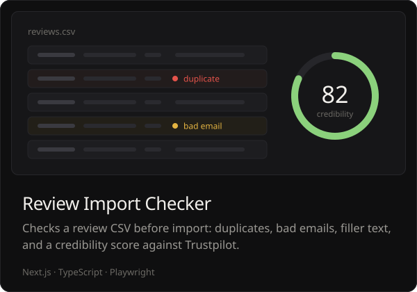
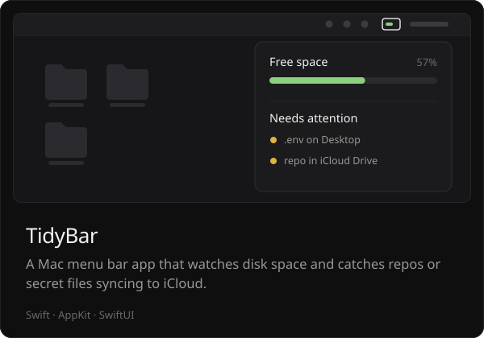
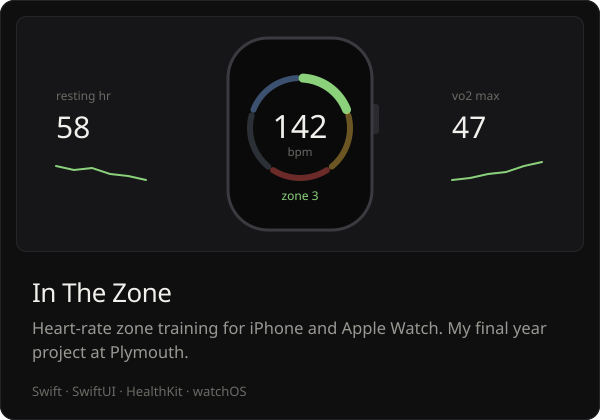

  

 

I'm a Product & Solutions Consultant at [clearer.io](https://clearer.io), working on Boost AI Search & Discovery for Shopify merchants and the agencies behind them. Most days that means reading theme code, working out why a product ranks where it does, and fixing the integration so it stays fixed.

When the same job comes up twice, I build a tool for it. Most of what's below started that way.

 

### Selected work

  
  

  
  

  
  

Linked cards open the repo. Hugo and TidyBar are private.

 

### Toolkit

<b>Commerce</b> &nbsp; Shopify, Liquid, Boost, Shopify CLI, Admin GraphQL 
<b>Code</b> &nbsp; JavaScript, TypeScript, Python, Swift, SQL 
<b>Web and apps</b> &nbsp; Node.js, Next.js, Flask, Tailwind, SwiftUI 
<b>Shipping</b> &nbsp; GitHub Actions, Playwright, Postman, Firebase, Cloudflare

 

### Background

Computer Science at the University of Plymouth, finishing with [In The Zone](https://github.com/alex-brankin/In-The-Zone) as my final year project. Since then it's been Shopify and e-commerce: search, merchandising, theme integrations, and the internal tools that keep a small team quick. Outside work I build Discord games under Odyssey Studios and the odd Mac utility.

### Get in touch

Want access to boost-cli, or a second pair of eyes on a Boost setup? Email [alex@clearer.io](mailto:alex@clearer.io).
